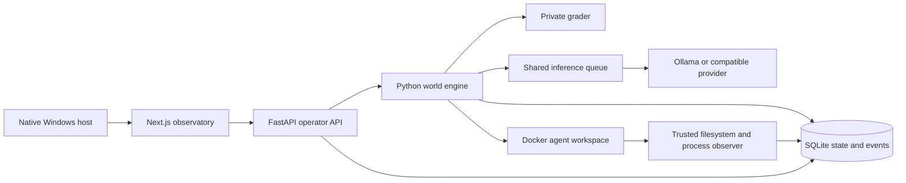

# Architecture

[Documentation index](README.md)

Ageatopia separates the agent environment from the trusted operator system. Python
owns simulation state and grading; the dashboard presents recorded state. A C
Win32 host embeds the dashboard through WebView2.

## Components

| Area | Responsibility |
| --- | --- |
| [backend](../src/backend/) | API, lifecycle, economics, tasks, grading, persistence, exports, and offline training |
| [hooks](../src/hooks/) | Provider contracts, resource admission, Docker execution, and observation |
| [gui](../src/gui/) | Service supervision, control/maintenance TUIs, native host, and dashboard |
| [scripts](../src/scripts/) | Windows entry points, dashboard build routing, and verification |
| [db](../db/) | Drizzle schema and migrations for shared data definitions |

## State and time

The engine stores time and lifetime deductions in integer milliseconds. A per-run
lock orders actions; expiration precedes another action at an equal timestamp.
State changes and versioned events commit together. SQLite runs in WAL mode, and
Python transactions use SQLAlchemy. Drizzle supplies the mirrored TypeScript
schema; it is not the engine's transaction coordinator.

Wall and deterministic clocks are configurable. Queue wait and model work are
accounted separately. Pausing stops ongoing work; recovery resumes from durable
state without charging offline wall time. A recovered identity is retained, while
a replacement receives a new identity with explicit parent lineage.

## Agent boundary

Each world uses a disposable Docker container with a shared, size-bounded tmpfs
workspace and separate unprivileged agent UIDs. Agent execution has no host shell
fallback. The root filesystem is read-only; resources, output, and execution time
are bounded. The container has no host bind mounts, external network, Docker
socket, private database, operator token, or grader code.

Agent-facing task and tool results use explicit public-field allowlists. The
private grader distinguishes verified, incorrect, malformed, and infrastructure
outcomes without disclosing hidden answers or impossibility classifications.
Terminating an identity kills its owned programs, including detached descendants.

Implementation: [engine.py](../src/backend/engine.py),
[grader.py](../src/backend/grader.py), and [sandbox.py](../src/hooks/sandbox.py).

## Inference and experience

Requests share a concurrency limit while agent histories and exact delivered
contexts remain distinct. Local models preload with their configured contexts
before lifetime charging and request residency with `keep_alive=-1`. Admission
checks do not reserve all physical memory; allocation errors remain visible.

Notebook entries, outcome experience, reflections, and reported intentions are
durable state. Retrieval uses relevant lexical/recent candidates and optional
embedding ranking. Replacement notebook inheritance is configurable; unrelated
identities' private notebooks and private grader data are excluded.

Recorded reasoning is provider-returned text, and recorded feelings are agent
self-reports. The application does not infer hidden thoughts. Context summaries
preserve original history in events; context limits can stop an agent visibly.
Offline LoRA is a separate, explicitly invoked workflow.

## Observation and operator access

The trusted observer records process events and filesystem notifications/content
checkpoints outside the agent boundary. Batches are acknowledged after durable
commit and deduplicated on retry. Overflow pauses a world visibly. Filesystem
notifications may coalesce writes, so snapshots represent observed versions rather
than a byte-by-byte record of every intermediate write.

The dashboard server proxies authenticated API requests. The operator token stays
server-side, outside browser state and agent prompts. Services bind to loopback;
`/health` is public and operator routes require a bearer credential. Events support
live observation, replay, and complete exports.

The native host embeds the web renderer and provides native menus, DPI-aware
sizing, and external-link handling. The dedicated compiled launcher supervises bundled
backend, Node/dashboard, and native-host processes. See [releases](releases.md)
for the deployment layout and [operations](operations.md) for shutdown ownership.
